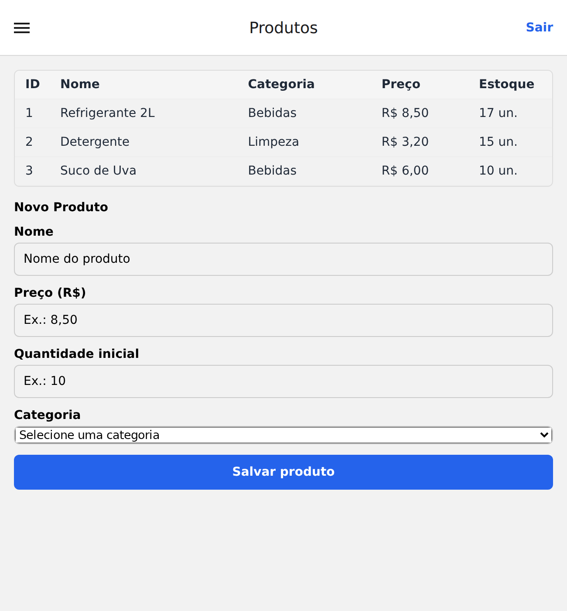
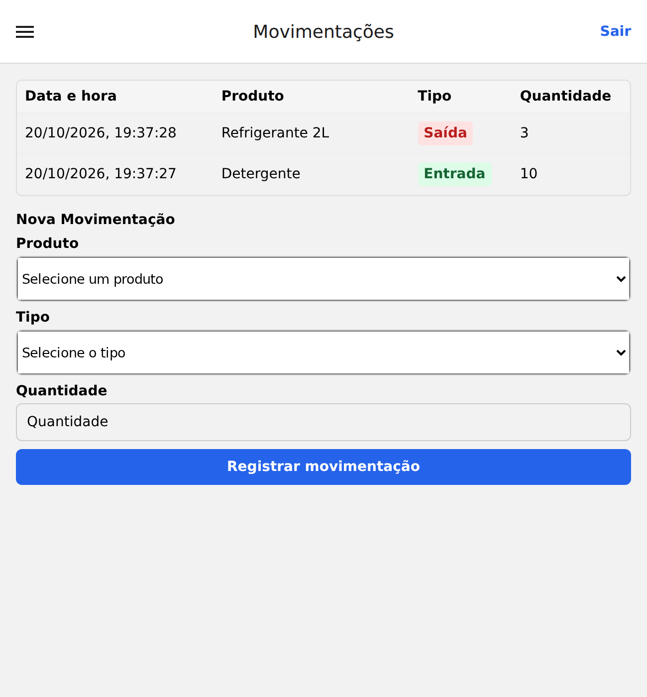

# Controle de Estoque — Atividades 01 e 02

Listagem e cadastro de **Produtos** e **Movimentações**, seguindo o padrão de componentes da tela de Categorias.

Base da disciplina: [projeto do professor Nelson Bellincanta](https://github.com/bellincanta/2026DispositivosMoveis/tree/main/projeto/appEstoque/frontend).

## Como executar

Na pasta que contém o `package.json`, execute:

```bash
npm ci
npm start
```

Para abrir diretamente no navegador:

```bash
npm run web
```

Ambiente usado na validação: Node.js 24.19.0, npm 11.9.0 e as dependências originais do projeto.

### Login de demonstração

- **E-mail:** `professor@ifpr.edu.br`
- **Senha:** `123456`

## Funcionalidades

### Produtos

- Lista ID, nome, categoria, preço em reais e quantidade em estoque.
- Exibe uma mensagem quando não há produtos.
- Cadastra nome, preço, quantidade inicial e uma categoria existente.
- Valida os campos obrigatórios e os valores numéricos; aceita preço como `6,00` e quantidade inicial zero.
- Atualiza a lista e limpa o formulário após cadastrar.

### Movimentações

- Lista data/hora em formato brasileiro, produto, tipo e quantidade.
- Exibe Entrada em verde e Saída em vermelho, com a movimentação mais recente no topo.
- Mostra o estoque atual nas opções de produtos.
- Exige produto, tipo e quantidade inteira maior que zero.
- Apresenta o erro da API se a saída ultrapassar o estoque disponível.
- Atualiza o histórico e o estoque das opções e limpa o formulário após registrar.

As telas recarregam os dados ao serem abertas pelo menu lateral. A navegação e o botão Sair continuam com a configuração original.

## Organização

| Tela | Listagem | Formulário |
|---|---|---|
| `src/screens/ProdutosScreen.tsx` | `src/components/ListaProdutos.tsx` | `src/components/FormularioProduto.tsx` |
| `src/screens/MovimentacoesScreen.tsx` | `src/components/ListaMovimentacoes.tsx` | `src/components/FormularioMovimentacao.tsx` |

Os arquivos `src/types/index.ts`, `src/api/api.ts` e `src/api/mockData.ts` foram preservados. Nenhuma dependência foi adicionada.

## Prints das telas

Capturas reais do aplicativo executado com Expo Web, após os exemplos da atividade. Os formulários aparecem limpos depois dos registros.

### Produtos



### Movimentações



## Validação

```bash
npx tsc --noEmit
```

O TypeScript passou sem erros. O aplicativo foi executado pelo Expo Web e o bundle Android foi gerado com `npx expo export --platform android`. A interação foi verificada no navegador; não foi realizado teste em aparelho físico.

| Cenário executado | Resultado |
|---|---|
| Cadastrar Suco de Uva, R$ 6,00, 10 unidades, Bebidas | Produto aparece imediatamente; formulário limpo |
| Entrada de 10 Detergentes | Registro no histórico e estoque de 15 unidades |
| Saída de 3 Refrigerantes | Registro no topo, tipo Saída destacado e estoque de 17 unidades |
| Voltar para Produtos | Saldos atualizados para 15 e 17 unidades |
| Enviar campos vazios ou movimentação com quantidade zero | Envio recusado |
| Tentar saída de 999 Refrigerantes | Mensagem de estoque insuficiente, sem registro adicional |

**Dados de demonstração:** a API original usa dados em memória. Ao recarregar o aplicativo, produtos e movimentações voltam ao estado inicial. A sessão de login utiliza AsyncStorage.

## Entrega no GitHub

Publique o conteúdo desta pasta no seu repositório e entregue o link. Inclua o `README.md` e a pasta `docs`, que contém os prints. A pasta `node_modules` não faz parte do pacote e já está no `.gitignore`.
